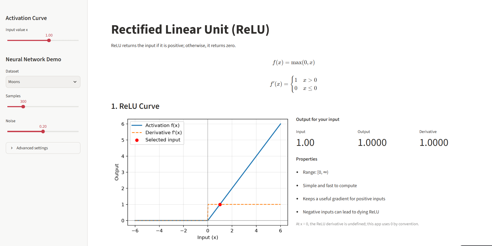
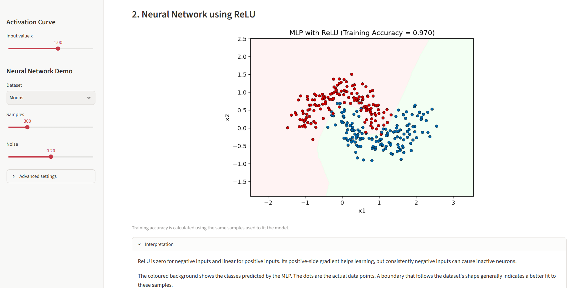
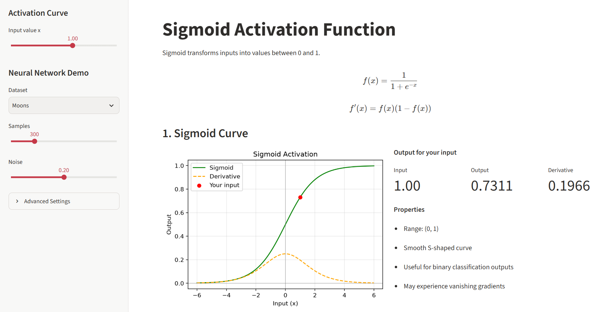
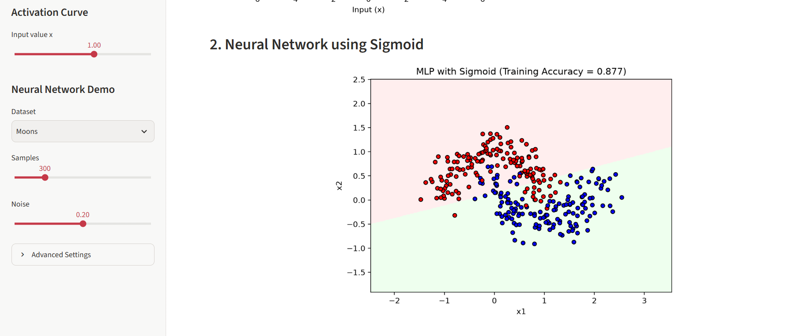
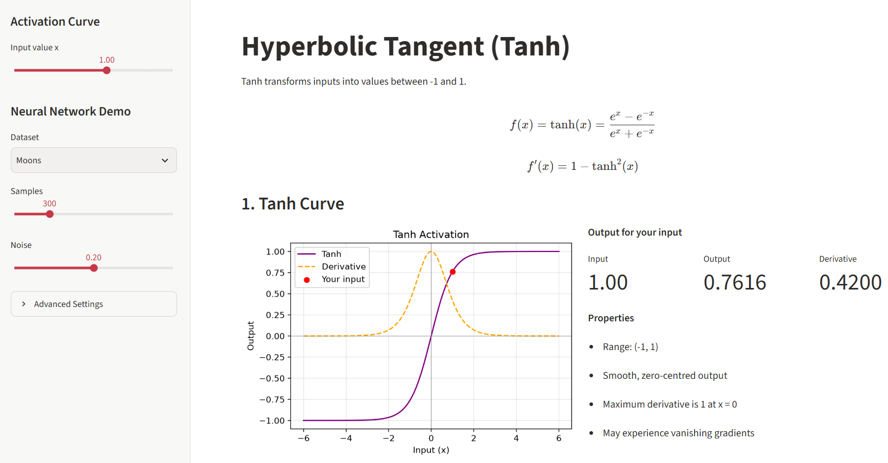
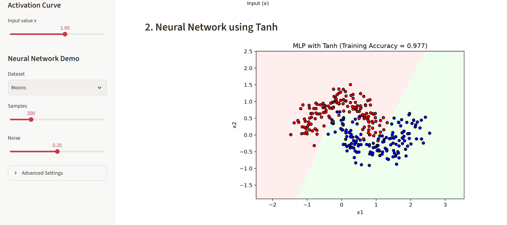

# 🧠 Activation Function Visualiser: ReLU, Sigmoid & Tanh

**BSD3513 Introduction to Artificial Intelligence · Lab Report 4**

**SD24048 WONG JIA YING**

🌐 **Live Applications:**
- **ReLU:** [https://lab-report-4-ayhq52caxvc8atsqequs4v.streamlit.app/ ]
- **Sigmoid:** [https://lab-report-4-hasmddrzdg3cjiapaakrps.streamlit.app/ ]
- **Tanh:** [https://lab-report-4-42vsxi9dinnbyj6jp9btb3.streamlit.app/ ]

💻 **Source Code:** [https://github.com/wongjiaying-wjy/Lab-Report-4 ]

---

## 📌 About

This project consists of three separate interactive web applications developed using Streamlit to visualise the Rectified Linear Unit (ReLU), Sigmoid, and Hyperbolic Tangent (Tanh) activation functions.

Each application allows users to explore how an activation function transforms input values, observe its derivative, and understand its behaviour in neural network classification.

The applications also demonstrate how a Multi-Layer Perceptron (MLP) uses different activation functions to classify synthetic datasets.

## 🧮 Activation Functions

| Activation Function | Formula | Output Range |
|---|---|---|
| ReLU | f(x) = max(0, x) | [0, ∞) |
| Sigmoid | f(x) = 1 / (1 + e⁻ˣ) | (0, 1) |
| Tanh | f(x) = tanh(x) | (-1, 1) |

- **ReLU:** Returns zero for negative inputs and the input value for positive inputs. It is computationally efficient but may experience the dying ReLU problem.
- **Sigmoid:** Produces smooth outputs between zero and one but may experience vanishing gradients.
- **Tanh:** Produces zero-centred outputs between negative one and one but may also experience vanishing gradients.

---

## ⚙️ Application Features

### 1. Interactive Activation Curve

Each application displays the activation function and its derivative on the same graph.

Users can adjust the input value using a slider to observe changes in the output and gradient.




### 2. Output Values and Properties

The applications display three values:

- **Input:** The selected input value.
- **Output:** The value after applying the activation function.
- **Derivative:** The gradient at the selected input value.

Each application also describes the main properties, advantages, and limitations of its activation function.




### 3. Neural Network Demonstration

Each application trains a Multi-Layer Perceptron (MLP) classifier using its corresponding activation function.

Users can adjust the following parameters:

| Parameter | Description |
|---|---|
| Dataset | Moons or Circles |
| Samples | Number of generated data points (100–1000) |
| Noise | Amount of noise (0.00–0.40) |
| Hidden Layer Sizes | Number of neurons in each hidden layer |
| Max Iterations | Maximum training iterations |

The input features are standardised using `StandardScaler` before training.

### 4. Decision Boundary Visualisation

The decision boundary shows how the trained neural network separates two classes.

The coloured regions represent predicted classes, while the plotted points represent the actual dataset.

Each application also displays the **training accuracy**, which measures performance on the data used for training.




---

## 📊 Interpretation

The three activation functions have different characteristics that influence neural network learning.

- **ReLU:** Helps reduce vanishing gradients for positive inputs but may produce inactive neurons for negative inputs.
- **Sigmoid:** Produces bounded outputs between zero and one but may learn slowly when gradients become small.
- **Tanh:** Produces zero-centred outputs but may also experience vanishing gradients for large input values.

By using the same dataset and neural network settings, users can compare the resulting decision boundaries and training accuracies.

The results depend on the dataset, noise level, network architecture, and number of training iterations.

---

## 🚀 How to Run

1. Clone or download this repository.

2. Install the required libraries:

   ```bash
   pip install -r requirements.txt
   ```

3. Run each application separately.

   **ReLU:**
   ```bash
   streamlit run relu_app.py
   ```

   **Sigmoid:**
   ```bash
   streamlit run sigmoid_app.py
   ```

   **Tanh:**
   ```bash
   streamlit run tanh_app.py
   ```

4. Open the Streamlit application in your browser and adjust the sidebar settings.

---

## 🧠 How the Neural Network Works

1. Generate a synthetic Moons or Circles dataset.
2. Standardise input features using `StandardScaler`.
3. Create an MLP classifier with the selected activation function.
4. Train the neural network using the generated dataset.
5. Calculate the training accuracy.
6. Predict classes across a grid of input values.
7. Visualise the decision boundary.

The three applications use the same default neural network settings, except for their activation functions.

---

## 📁 Repository Structure

```text
Lab-Report-4/
│
├── relu_app.py
├── sigmoid_app.py
├── tanh_app.py
├── requirements.txt
├── README.md
│
└── image/
    ├── relu.png
    ├── sigmoid.png
    └── tanh.png
```

## 🛠️ Built With

- **Python** – Programming language
- **Streamlit** – Interactive web application
- **NumPy** – Numerical calculations
- **Matplotlib** – Graph visualisation
- **Scikit-learn** – Dataset generation, preprocessing, and MLP classification

## ⏱️ Complexity Note

Each application generates 400 points for the activation curve and uses a 250 × 250 grid (62,500 points) for the decision boundary.

The computational cost of training depends on the number of samples, hidden-layer sizes, and maximum iterations. Larger networks and higher iteration limits may increase processing time.

---

**BSD3513 Introduction to Artificial Intelligence | Lab Report 4**

**SD24048 WONG JIA YING**

